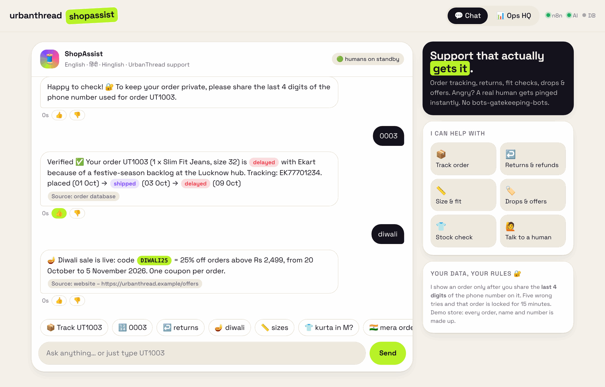
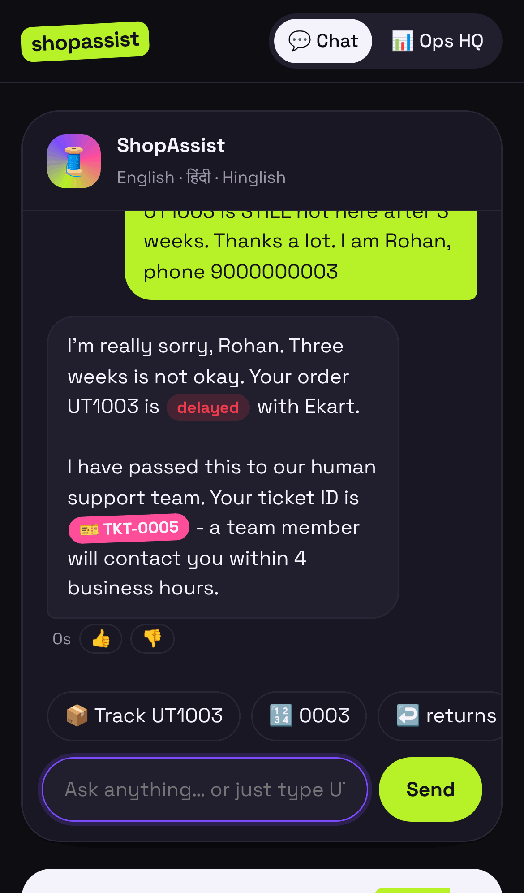
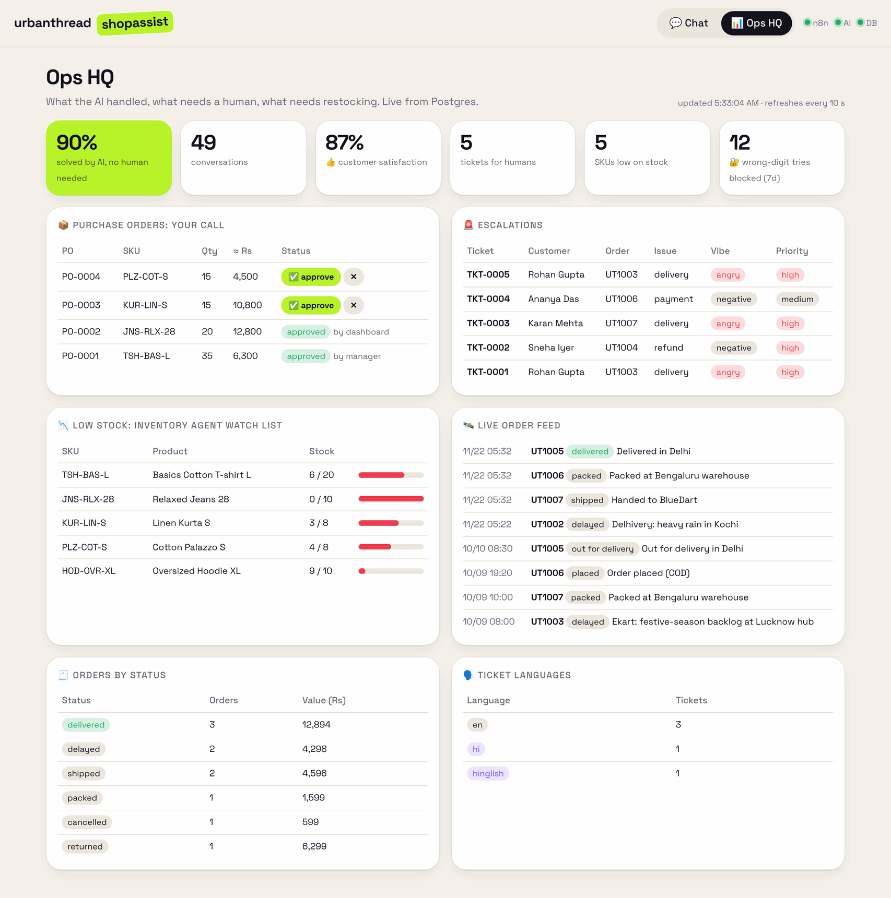
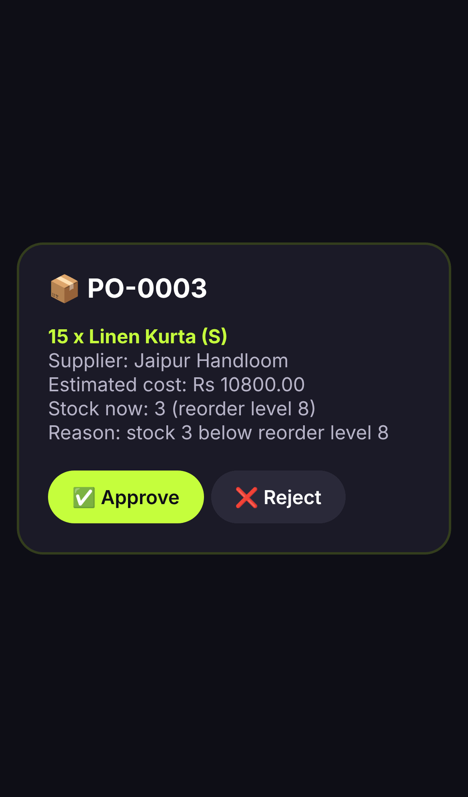
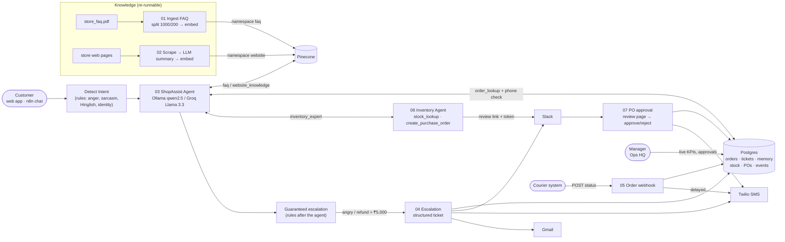

<div align="center">

# 🧵 ShopAssist

### The AI support teammate for **UrbanThread**, an Indian online clothing store

*Tracks orders, explains returns, drops coupon codes, checks stock, talks Hinglish,
and pings a human the second a customer gets upset.*

[](https://github.com/kritikab01/ShopAssist-AI/actions/workflows/ci.yml)


**7 n8n workflows · 2 AI agents · 2 knowledge bases · 58 automated tests · runs for ₹0**

### 🌐 Live app: **[shopassistai.vercel.app](https://shopassistai.vercel.app)**

<sub>Hosted on Vercel, redeployed automatically from <code>main</code>. The chat answers when the n8n backend is online
(see <a href="docs/DEPLOY.md#d-vercel-the-live-link">docs/DEPLOY.md</a>).</sub>



</div>

| 📱 Hinglish, sarcasm, instant escalation | 📊 Ops HQ, the manager's dashboard | ✅ One-tap purchase-order approval |
|:---:|:---:|:---:|
|  |  |  |

<sub>Screenshots of the real UI. Ops HQ shows test data; chat replies replay answers from the evaluation run. The review page is
served live by n8n workflow 07. All brands, people, orders and phone numbers are fictional.</sub>

---

## The problem → the fix

**UrbanThread** has two support people. During the Diwali rush they drown in *"where is my order?"*, *"what's
the return policy?"* and *"is there a coupon?"*, while the one furious customer waits in the same queue as
everyone else. Nobody gets alerted, and nothing is recorded.

**ShopAssist** answers the repetitive 80% instantly, 24×7, **only from the store's own data**, and makes sure
the other 20% reaches a human fast, with a structured ticket, a Slack alert, an SMS and an e-mail.

| A customer says… | ShopAssist does… | Built with |
|---|---|---|
| "What's your return policy?" | answers from the **store FAQ PDF** and cites it | RAG: Pinecone namespace `faq` |
| "diwali" (one word is enough) | gives **DIWALI25** from the scraped offers page, never an invented code | scraping + LLM summaries, namespace `website` |
| "Where is UT1003?" | asks for the **last 4 phone digits** first, then shows status + timeline | Postgres, identity check with lockout |
| "mera order kab aayega?" | replies **in Hinglish** (or हिंदी) | rule-based language detection |
| "Wow amazing service 🙄 still not here" | spots the **sarcasm** → apologises → **ticket TKT-0005** | guardrails + escalation sub-workflow |
| "Refund my ₹7,499 order" | can't approve over ₹5,000 → **guaranteed** human ticket | rules after the agent, not just the prompt |
| "Is the linen kurta in M?" | asks the **Inventory Agent** (a 2nd AI agent) | multi-agent: agent-as-a-tool |
| "Restock the T-shirt L" | drafts **PO-0004** → manager approves in one tap → supplier gets an SMS | human-in-the-loop, workflow 07 |
| "Write me a Python script" | politely stays in its lane | out-of-scope guard |

## Architecture



### The seven workflows

| # | Workflow | Trigger | What it does |
|---|---|---|---|
| 01 | Ingest FAQ PDF | manual | PDF → 1000/200 chunks → 768-dim embeddings → **replaces** Pinecone namespace `faq` |
| 02 | Scrape & summarize | manual | 4 store pages → HTML text → LLM bullet summary → **replaces** namespace `website` (with URL for citations) |
| 03 | **Support agent** | public chat | Detect Intent rules → Tools Agent (memory + 5 tools) → guaranteed escalation → reply in the customer's language |
| 04 | Escalation | called by 03 | LLM + structured-output ticket → normalize (never fails) → Postgres → Slack + SMS + e-mail → ticket ID |
| 05 | Order webhook | `POST /webhook/order-update` | update order + status history → SMS if delayed |
| 06 | **Inventory Agent** | called by 03 | 2nd AI agent: stock lookup, purchase-order drafts (reorder rule) → Slack review links |
| 07 | PO approval | `GET po-review` / `POST po-decision` | read-only review page → token-checked decision → Slack + supplier SMS |

## Why it's more than a demo

Small local models forget things, so **every business rule that matters lives in the workflow, not in the prompt.**
That one design decision took the evaluation from 9/14 to 14/14.

**🔐 Privacy & security**
- Orders are shown only with **order ID + last 4 phone digits**. Every check is logged; **5 wrong tries lock the order** for 15 min.
- The fallback reply (used when the AI fails) can **never** reveal an unverified order. A test enforces this.
- All SQL uses **query parameters** (no injection). A test fails the build if an expression sneaks into SQL.
- PO approval links carry a **per-PO secret token**, and opening the link changes nothing (link previews and mail scanners are harmless).
  Only the Approve/Reject POST does, and only once.
- Web app: **admin key** for the dashboard, **per-IP rate limit**, message size limit, security headers. Secrets live only in `.env`; CI scans for leaked keys.

**🛟 Reliability**
- **Guaranteed escalation**: if the customer is angry, sarcastic or asks for >₹5,000 back and the reply has no ticket ID, the workflow creates the ticket itself.
- The ticket **normalizer** turns any model output (even garbage) into a valid ticket. Every tool input has a default. Every workflow has a time limit.
- Re-running ingestion is safe: each knowledge base **replaces its own namespace** (no duplicate vectors).

**🧪 Quality you can measure**
- `scripts/evaluate.py`: **17 scored conversations** checked three ways: keywords, **live-database facts**, and an **AI judge**
  (a bigger model grades the small one, 1–5, and flags invented facts).
- **58 pytest tests** run in **GitHub Actions** on every push: workflow structure, the generated files match the generator,
  the guardrail JavaScript run with Node (anger, sarcasm, Hindi/Hinglish, identity check), and **every SQL query against a real Postgres 16**.

**📈 Business KPIs** (live in Ops HQ, `scripts/kpi_report.py`): share solved without a human, CSAT from 👍/👎,
tickets by type, sentiment and language, low-stock SKUs, POs pending and decided, blocked identity checks.

## Run it

| Option | Command | Details |
|---|---|---|
| 🐳 **Everything in Docker** | `bash scripts/up.sh` | Postgres (with data) + n8n + web app, imports and publishes all workflows |
| 🔗 **Public demo link** | `bash scripts/share_demo.sh` | free Cloudflare tunnel to the web app only; dashboard protected by `ADMIN_KEY` |
| ☁️ **Cloud, no laptop** | Render blueprint + `import_to_n8n.py --cloud --publish` | Groq (Llama 3.3 70B) + Cohere multilingual embeddings + Supabase + Pinecone |
| 💻 Existing local n8n | see [`docs/RUNBOOK.md`](docs/RUNBOOK.md) | step by step, with what you should see after each step |

Full guide: **[`docs/DEPLOY.md`](docs/DEPLOY.md)**. Local AI needs the [Ollama](https://ollama.com) app and
`ollama pull qwen2.5:3b && ollama pull nomic-embed-text`.

### Everyday commands

| Command | What it does |
|---|---|
| `python3 app/server.py` | web app on http://localhost:8501: 💬 chat + 📊 Ops HQ |
| `python3 scripts/import_to_n8n.py [--publish] [--cloud]` | create/update the 7 workflows and credentials in n8n |
| `python3 scripts/doctor.py` | read-only diagnosis: .env, Ollama, Pinecone namespaces, workflows, chat port, last errors |
| `python3 scripts/chat_cli.py` | chat in the terminal |
| `python3 scripts/evaluate.py` | 17 scored tests + AI judge → `docs/evaluation_results.md` |
| `python3 scripts/kpi_report.py` | business KPIs → `docs/kpi_report.md` |
| `pytest` | the test suite (set `PGHOST` etc. to include the SQL tests) |
| `python3 scripts/build_workflows.py` | regenerate `workflows/*.json` (local + cloud) from the code and `prompts/` |

## Try these

```
UT1003                      → asks for the phone digits, shows nothing yet
0003                        → verified: delayed with Ekart + timeline
UT1002, phone ends 9999     → digits don't match → no details
diwali                      → DIWALI25, 25% off above ₹2,499
mera order UT1003 kab aayega? last 4 digits 0003   → Hinglish answer
Wow great service 🙄 still not delivered            → sarcasm → ticket
I returned UT1004, refund me now                    → over ₹5,000 → ticket
Is the linen kurta available in size M?             → Inventory Agent
Restock the Basics T-shirt size L                   → PO draft → approve in Ops HQ
```

All 17 with expected behaviour: [`docs/test_questions.md`](docs/test_questions.md).

## Stack (all free)

| Layer | Local | Cloud |
|---|---|---|
| Orchestration | n8n 2.48 (Docker) | n8n on Render, data in Supabase schema `n8n` |
| Chat model | Ollama `qwen2.5:3b` (tool calling) | Groq `llama-3.3-70b-versatile` |
| Embeddings | Ollama `nomic-embed-text` (768) | Cohere `embed-multilingual-v3.0` (1024) |
| Vector DB | Pinecone index `shopassist`, namespaces `faq` / `website` | Pinecone `shopassist-cloud` |
| Database + memory | Postgres 16 / Supabase | Supabase |
| Alerts | Slack · Twilio SMS · Gmail SMTP | same |
| App | Python standard library + pg8000, one HTML file | Docker on Render |

## Repository map

```
workflows/          01–07 n8n workflows (generated, never hand-edited)   workflows/cloud/  same for Groq + Cohere
scripts/            build_workflows.py (the source of the workflows) · import_to_n8n.py · up.sh · share_demo.sh
                    doctor.py · evaluate.py · kpi_report.py · setup_database.py · setup_pinecone.py · chat_cli.py
prompts/            agent_system_prompt.md · inventory_agent_prompt.md · detect_intent.js · ticket_schema.json
database/           schema.sql (9 tables, re-runnable) · seed.sql (10 orders, 12 products, order history)
app/                server.py + index.html (chat + Ops HQ)
tests/              58 pytest tests (workflows, guardrails via Node, SQL on Postgres, evaluation helpers)
docs/               DEPLOY.md · RUNBOOK.md · report.md · test_questions.md · course_mapping.md · screenshots/
docker-compose.yml  Dockerfile  render.yaml  .github/workflows/ci.yml
```

## Honest limitations

- The identity check is "last 4 digits + lockout", not a real SMS OTP (next step: Twilio Verify).
- The 3B local model is slow (~10 s per answer) and needs the guardrails; the cloud profile uses a 70B model.
- Hinglish and sarcasm detection are word lists: good on common phrasing, not on everything.
- Free tiers: Twilio trial only texts verified numbers; Render free instances sleep after 15 minutes idle.
- All data is fictional; there is no real payment or courier integration.

## Course mapping and report

Capstone for *Agentic AI for Business Automation* (FORE School of Management). Session-by-session mapping:
[`docs/course_mapping.md`](docs/course_mapping.md). Report: [`docs/report.md`](docs/report.md) (v2 changes in
section 6b) · submitted Word/PDF versions (v1, 10 Oct 2026) in [`docs/submission/`](docs/submission/).

MIT License.
