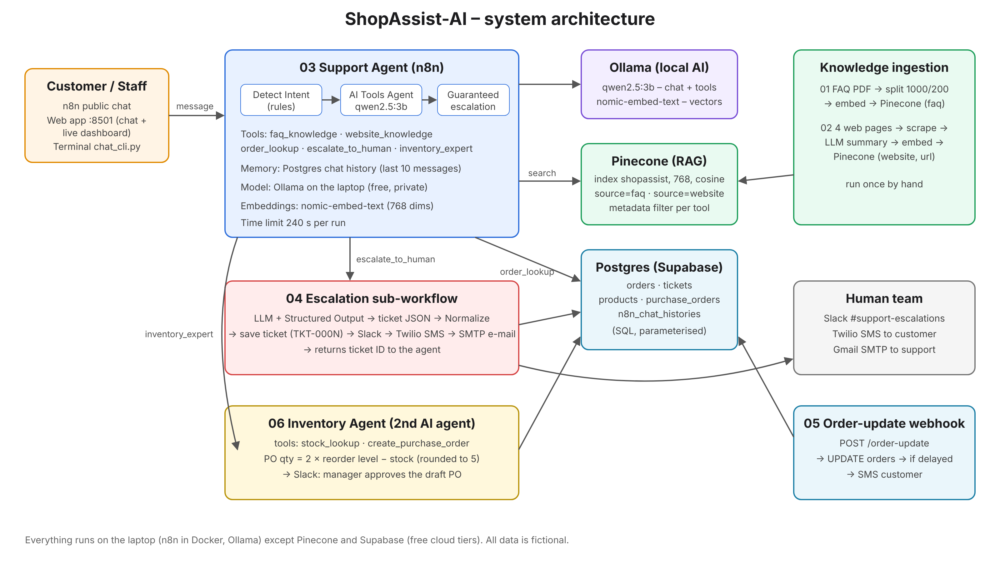
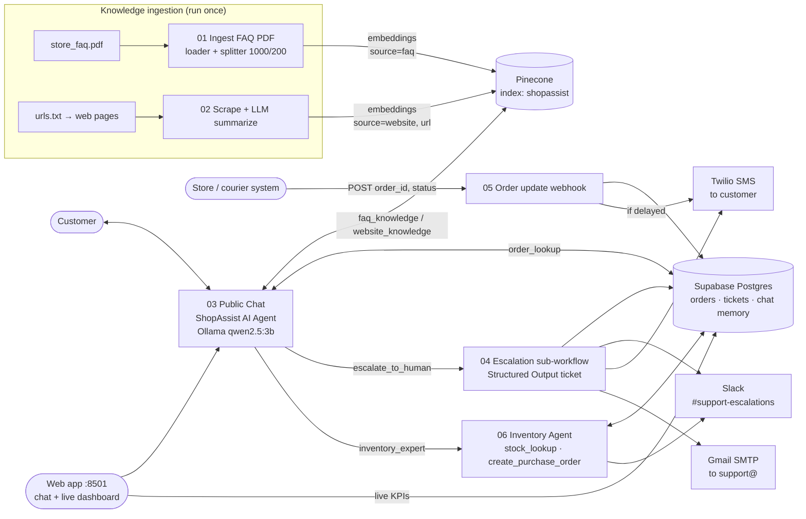

# ShopAssist-AI

**Agentic RAG customer-support agent for an online clothing store, built with n8n, Ollama (local AI), Pinecone,
Supabase Postgres, Twilio, Slack and Gmail SMTP.**

All services used are free tiers or run locally; no credit card needed.
(n8n runs self-hosted on your computer; the AI models run locally with Ollama.)

Individual capstone – *Agentic AI for Business Automation*.
All data (brand, customers, orders, phone numbers, policies) is **fictional**.

---

## Submission files

- **Report (Word):** [`docs/submission/ShopAssist_AI_Capstone_Report.docx`](docs/submission/ShopAssist_AI_Capstone_Report.docx)
- **Technology Stack Guide (Word):** [`docs/submission/ShopAssist_AI_Tech_Stack_Guide.docx`](docs/submission/ShopAssist_AI_Tech_Stack_Guide.docx)
- **Screenshots** (architecture, all six workflow canvases, two executions, web app): [`docs/screenshots/`](docs/screenshots/)
- Markdown version of the report: [`docs/report.md`](docs/report.md)



## 1. Problem

*UrbanThread* is a small online clothing store in India (prices in Rs). Its two support staff spend most
of the day answering the same questions: *Where is my order? What is the return policy? Which size
should I buy? Is COD available?* Replies are slow, angry customers wait in the same queue as simple
questions, and nobody is alerted when an issue is urgent.


## 2. Solution

**ShopAssist** is an AI agent on a public chat URL that:

1. answers policy questions from the **store FAQ PDF** (knowledge base 1, Pinecone `source=faq`);
2. answers questions about offers, shipping partners, fit tips etc. from **scraped and summarized web
   pages** (knowledge base 2, Pinecone `source=website`);
3. looks up **orders in Postgres** by order ID or phone number;
4. **escalates** angry customers, refunds above Rs 5,000 and unanswered questions to a human: it creates a
   structured ticket in Postgres, posts to **Slack**, sends the customer an **SMS (Twilio)** and **e-mails**
   the support team;
5. sends an **SMS automatically when an order is delayed** (order-update webhook);
6. works as a **team of two domain-expert agents**: the support agent hands stock and procurement questions
   to an **Inventory Agent**, which checks live stock and drafts purchase orders for manager approval;
7. understands **one-word messages** (`UT1002`, `returns`, `diwali`, `stock`) and comes with a **web app**
   (chat + live business dashboard), a **Terminal chat**, an **automatic evaluation** and a **KPI report**.

**Start here: [`docs/RUNBOOK.md`](docs/RUNBOOK.md)** – every step in order, with what you should see.

## 3. Architecture



## 4. Repository layout

```
workflows/   01–05 n8n workflow JSON files (import these)
database/    schema.sql (orders, tickets, chat memory) · seed.sql (10 fake orders)
data/        store_faq.md + store_faq.pdf · urls.txt · pages/*.html (fake web pages to scrape)
prompts/     agent_system_prompt.md · ticket_schema.json
docs/        course_mapping.md · test_questions.md · report.md
scripts/     build_workflows.py (regenerates workflows/*.json) · import_to_n8n.py · setup_pinecone.py ·
             verify_setup.py (read-only checks) · make_faq_pdf.py (md → pdf)
.env.example credential checklist (placeholders only)
```

| Workflow | Trigger | What it does |
|----------|---------|--------------|
| `01_ingest_faq_pdf.json` | Manual | Download FAQ PDF → Default Data Loader + Recursive splitter (1000/200) → Ollama embeddings (768) → Pinecone, `source=faq` |
| `02_scrape_and_summarize.json` | Manual | Read `urls.txt` → HTTP Request each page → HTML extract → LLM summary → embeddings → Pinecone, `source=website`, `url` |
| `03_support_agent_chat.json` | Public Chat | Tools Agent + Postgres Chat Memory + tools `faq_knowledge`, `website_knowledge`, `order_lookup`, `escalate_to_human`, `inventory_expert` (→ 06); rule-based *Detect Intent* before and *guaranteed escalation* after the agent (creates the ticket via 04 if the model forgot) |
| `04_escalation_subworkflow.json` | Called by 03 | LLM + Structured Output Parser → `tickets` insert → Slack → Twilio SMS → SMTP e-mail → returns ticket ID |
| `05_order_update_webhook.json` | Webhook POST | Update order status → if `delayed`, SMS the customer → JSON response |
| `06_inventory_agent.json` | Called by 03 | **Second AI agent** (Inventory): tools `stock_lookup` + `create_purchase_order` (Postgres) → Slack approval request → answer back to 03 |

## 5. Accounts and credentials (all free, no credit card)

| What | Used in | How to get it |
|------|---------|---------------|
| **Ollama** (local AI, no key) | 01–04 | Install from **ollama.com**, open the app, then `ollama pull qwen2.5:3b` and `ollama pull nomic-embed-text`. The n8n credential is created for you by `scripts/import_to_n8n.py`. |
| **Pinecone** | 01–03 | app.pinecone.io → API keys. Index `shopassist`, **768** dims, cosine (`scripts/setup_pinecone.py` creates it). |
| **Postgres** | 03–05 | Supabase → **Connect** → *Session pooler*: host, port 5432, database `postgres`, user `postgres.<project-ref>`, password; SSL on |
| **Slack API** | 04 | api.slack.com/apps → create app → Bot scopes `chat:write`, `channels:read` → install → Bot token `xoxb-…` |
| **Twilio API** | 04, 05 | twilio.com/console → Account SID + Auth Token; claim a trial number; verify your own phone |
| **SMTP** | 04 | Gmail: host `smtp.gmail.com`, port 465, SSL, user = your Gmail, password = **App Password** |

Secrets go only into n8n and your local `.env` (git-ignored; template `.env.example`). **Never commit or share real keys.**

Why Ollama? The project first used Google Gemini's free tier, but Google refused API access for the
student's Google projects ("403 project denied"). Ollama runs the models on your own computer: free,
no API key, no rate limits, and nothing that can be blocked.

## 6. Setup (≈ 60 minutes, self-hosted n8n on your computer)

1. **Ollama** – install from ollama.com, open the app, then in Terminal:
   `ollama pull qwen2.5:3b` and `ollama pull nomic-embed-text` (≈ 2.5 GB). With 16 GB RAM or more you can
   use `qwen2.5:7b` for better answers (change `CHAT_MODEL` in `scripts/build_workflows.py`).
2. **Supabase** – new project → SQL Editor → run `database/schema.sql`, then `database/seed.sql`.
   For the SMS demo, change one order's `phone` to your Twilio-verified number.
3. **`.env`** – `cp .env.example .env`, fill in `N8N_API_KEY` (n8n → Settings → n8n API), `PINECONE_API_KEY`
   and the `POSTGRES_*` values.
4. **Pinecone index** – `python3 scripts/setup_pinecone.py` (creates `shopassist`, 768 dims, cosine; if an
   index with another size exists it asks before recreating it).
5. **GitHub** – keep this repo **public**; workflows 01/02 download `data/` files from
   `raw.githubusercontent.com/.../main/...` (or change `main` in those URLs and `data/urls.txt`).
6. **n8n credentials** – create **Pinecone** and **Postgres** credentials in n8n (Credentials → Create).
7. **Import workflows** – `python3 scripts/import_to_n8n.py` (reads `.env` itself). It creates or
   updates all 5 workflows, creates the **Ollama** credential, creates *placeholder* Slack/Twilio/SMTP
   credentials (so 04/05 can be published before Part B), puts your only credential of each type on every
   node, and links 03 → 04. Re-running it after `git pull` updates the workflows and keeps your credentials.
8. **Check** – `pip3 install pg8000` then `python3 scripts/verify_setup.py` (read-only). Continue when it says
   *All checks passed*.
9. **Load knowledge** – in n8n open 01 → *Execute workflow*, then 02 → *Execute workflow* (once each;
   re-running duplicates vectors). Pinecone should then hold ≈ 10 records.
10. **Go live** – n8n 2.x: **Publish** workflow **04** first, then **03** and **05**. The chat calls the
    *published* version of 04. After any later edit, publish again. Open the Chat Trigger → copy the **Chat URL**.
11. **Test** – go through `docs/test_questions.md` and take screenshots for `docs/report.md`.
12. **Part B (real notifications)** – replace the placeholder Slack/Twilio/SMTP credentials with real ones, set
    the Twilio *From* number in 04 and 05 and the *From/To e-mail* in 04, then publish 04 and 05 again.

### Troubleshooting

| Error in n8n | Cause | Fix |
|--------------|-------|-----|
| *Mime type doesn't match selected loader* (01) | GitHub serves the PDF as `application/octet-stream` | Fixed by the **Set MIME Type to PDF** node. |
| *Vector dimension X does not match the dimension of the index* | Pinecone index has the wrong size | `python3 scripts/setup_pinecone.py` (768). |
| *fetch failed* / *ECONNREFUSED 11434* on an Ollama node | Ollama app not running, or n8n runs in Docker | Open the Ollama app. If n8n runs in Docker, set the Ollama credential's Base URL to `http://host.docker.internal:11434`. |
| *model "qwen2.5:3b" not found* | Model not downloaded | `ollama pull qwen2.5:3b` (and `nomic-embed-text`). |
| Chat answers are slow | Local model on a laptop | Normal for the first answer (model loading, ~30 s); later answers are faster. |
| Chat shows *Error: Failed to receive response* and the Logs panel stays empty | n8n sends chat messages to its **webhook URL**; with a non-default port (e.g. Docker `-p 5679:5678`) n8n thinks it is on 5678 | Run `bash scripts/fix_webhook_url.sh shopassist-n8n 5679` (recreates the Docker container with `WEBHOOK_URL`, keeps data, makes a backup). The Chat URL in the Chat Trigger node must start with `http://localhost:5679/`. `python3 scripts/doctor.py` checks this. |
| *Workflow is not active and cannot be executed* (during chat) | Workflow 04 is not published | Publish workflow 04. |
| *Cannot publish workflow … Missing required credential* | A node has no credential | Run the import script again (creates placeholders), or select the credential in the node. |
| Twilio *unverified number* | Trial account | Verify the phone in the Twilio console or use your own number in `seed.sql`. |

## Tools you run from the Terminal

| Command | What it does |
|---------|--------------|
| `python3 scripts/setup_database.py` | creates/updates all tables in Supabase and loads the fake data (safe to re-run) |
| `python3 scripts/import_to_n8n.py` | creates/updates workflows 01–06 in n8n, credentials, links between agents |
| `python3 scripts/doctor.py` | read-only diagnosis: code, `.env`, Ollama, workflows, chat port, last errors |
| `python3 scripts/test_chat.py` | tests Ollama, the chat (03) and the webhook (05) from the Terminal |
| `python3 scripts/chat_cli.py` | **interactive chat in the Terminal** – type anything, one word is fine |
| `python3 app/server.py` | **web app** on http://localhost:8501 – chat + live dashboard |
| `python3 scripts/evaluate.py` | asks 14 test questions, scores the answers → `docs/evaluation_results.md` |
| `python3 scripts/kpi_report.py` | business KPIs from the live database → `docs/kpi_report.md` |

## 7. Demo questions

1. *What is your return policy?* → FAQ answer with source
2. *Is there any Diwali discount code?* → website answer (DIWALI25) with page URL
3. *Where is my order UT1002?* → order lookup
4. *Order UT1005 doesn't fit – can I return it and when do I get my refund?* → order + FAQ combined
5. *When will my order arrive?* → asks for order ID
6. *Third time asking! UT1003 is late, I want a manager!* → escalation, ticket ID, Slack + SMS + e-mail
7. *Write me a Python script* → polite out-of-scope reply
8. *Refund my order UT1004 now* (Rs 7,499) → refund over Rs 5,000 → escalation
9. *UT1003* / *returns* / *diwali* (one word) → order status / return policy / Diwali offer
10. *Is the linen kurta available in size M?* → handed to the **Inventory Agent** → in stock
11. *low stock* → Inventory Agent lists products below their reorder level
12. *Restock the Basics T-shirt size L* → Inventory Agent drafts **PO-000N** (pending manager approval)

Full expected behaviour: [`docs/test_questions.md`](docs/test_questions.md).

## 8. Course mapping (summary)

| Course topic (sessions) | Where |
|-------------------------|-------|
| n8n basics, triggers, expressions, Code, IF (1–4) | All workflows; Code node (02), IF node (05) |
| LLMs, prompts, chains (5–6) | System prompt, summarization chain (02), ticket chain (04) |
| Embeddings, chunking, RAG with Pinecone (7–9) | 01, 02 insert; 03 retrieval tools |
| Structured output / schemas (10–11) | Structured Output Parser + `ticket_schema.json` (04) |
| AI agents, multi-agent, sub-workflows (12–13) | Support agent (03) + **Inventory Agent (06)** as `inventory_expert` tool; `escalate_to_human` → 04 |
| Agentic RAG, two knowledge bases (14–15) | `faq_knowledge` + `website_knowledge` |
| SMTP e-mail, public chat (16–17) | Gmail SMTP (04); public hosted chat (03) |
| Metadata filtering (18) | `source`, `url`, `title` metadata + filters |
| Agent + Postgres, memory (19–20) | `order_lookup`, Postgres Chat Memory, `tickets` |
| Slack, Twilio, scraping + summarization, capstone (21–24) | 02, 04, 05 |

Detailed table: [`docs/course_mapping.md`](docs/course_mapping.md). Report: [`docs/report.md`](docs/report.md).

## 9. Regenerating files (optional)

```bash
pip install reportlab
python scripts/make_faq_pdf.py      # data/store_faq.md -> data/store_faq.pdf
python scripts/build_workflows.py   # prompts/* -> workflows/*.json
```

## 10. Stack

| Purpose | Service (free tier) |
|---|---|
| Chat LLM | Ollama `qwen2.5:3b` (local, tool calling) |
| Embeddings | Ollama `nomic-embed-text` (768 dims, local) |
| Vector DB | Pinecone Starter |
| Database + chat memory | Supabase Free |
| SMS | Twilio trial |
| Alerts | Slack Free |
| E-mail | Gmail SMTP |
| Automation | self-hosted n8n (Community Edition) |

## 11. Limitations

Fake data only; a small local model (3B parameters) is slower and less accurate than large cloud models, and the chat only works while your computer, n8n and Ollama are running; a single Pinecone index with metadata filters (no namespaces); no authentication on the
public chat (anyone with the link can ask about an order ID); Twilio trial can only SMS verified numbers.
See the report for details and future scope (inventory agent + supervisor, Flowise version, larger models).

## License

MIT – see `LICENSE`.
