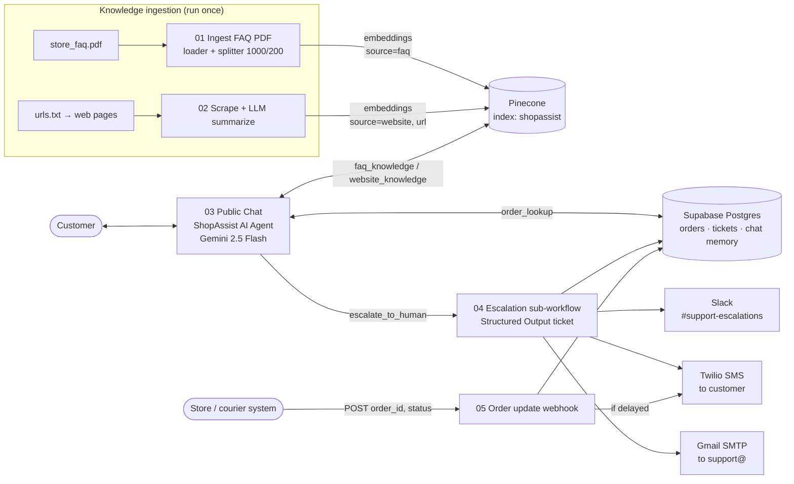

# ShopAssist-AI

**Agentic RAG customer-support agent for an online clothing store, built with n8n, Google Gemini, Pinecone,
Supabase Postgres, Twilio, Slack and Gmail SMTP.**

All services used are free tiers; no credit card needed.
(n8n Cloud is a free 14-day trial; to keep it free afterwards, self-host n8n Community Edition with Docker.)

Individual capstone – *Agentic AI for Business Automation*.
All data (brand, customers, orders, phone numbers, policies) is **fictional**.

---

## 1. Problem

*UrbanThread* is a small online clothing store in India (prices in Rs). Its two support staff spend most
of the day answering the same questions: *Where is my order? What is the return policy? Which size
should I buy? Is COD available?* Replies are slow, angry customers wait in the same queue as simple
questions, and nobody is alerted when an issue is urgent.

## 2. Solution

**ShopAssist** is an AI agent on a public chat URL that:

1. answers policy questions from the **store FAQ PDF** (knowledge base 1, Pinecone `source=faq`);
2. answers questions about offers, shipping partners, fit tips etc. from **scraped and summarized web
   pages** (knowledge base 2, Pinecone `source=website`);
3. looks up **orders in Postgres** by order ID or phone number;
4. **escalates** angry customers, refunds above Rs 5,000 and unanswered questions to a human: it creates a
   structured ticket in Postgres, posts to **Slack**, sends the customer an **SMS (Twilio)** and **e-mails**
   the support team;
5. sends an **SMS automatically when an order is delayed** (order-update webhook).

## 3. Architecture



## 4. Repository layout

```
workflows/   01–05 n8n workflow JSON files (import these)
database/    schema.sql (orders, tickets, chat memory) · seed.sql (10 fake orders)
data/        store_faq.md + store_faq.pdf · urls.txt · pages/*.html (fake web pages to scrape)
prompts/     agent_system_prompt.md · ticket_schema.json
docs/        course_mapping.md · test_questions.md · report.md
scripts/     make_faq_pdf.py (md → pdf) · build_workflows.py (regenerates workflows/*.json)
.env.example credential checklist (placeholders only)
```

| Workflow | Trigger | What it does |
|----------|---------|--------------|
| `01_ingest_faq_pdf.json` | Manual | Download FAQ PDF → Default Data Loader + Recursive splitter (1000/200) → Gemini embeddings → Pinecone, `source=faq` |
| `02_scrape_and_summarize.json` | Manual | Read `urls.txt` → HTTP Request each page → HTML extract → LLM summary → embeddings → Pinecone, `source=website`, `url` |
| `03_support_agent_chat.json` | Public Chat | Tools Agent + Postgres Chat Memory + tools `faq_knowledge`, `website_knowledge`, `order_lookup`, `escalate_to_human` |
| `04_escalation_subworkflow.json` | Called by 03 | LLM + Structured Output Parser → `tickets` insert → Slack → Twilio SMS → SMTP e-mail → returns ticket ID |
| `05_order_update_webhook.json` | Webhook POST | Update order status → if `delayed`, SMS the customer → JSON response |

## 5. Credentials you need (all free, no credit card)

| n8n credential type | Used in | How to get it |
|---------------------|---------|---------------|
| **Google Gemini (PaLM) API** | 01–04 | aistudio.google.com → *Get API key* → Create API key (free, no card). In n8n the credential is called *Google Gemini(PaLM) Api*; leave Host as default |
| **Pinecone** | 01–03 | app.pinecone.io → API keys |
| **Postgres** | 03–05 | Supabase → Project Settings → Database → *Connection pooler* (Session mode, port 5432), SSL on |
| **Slack API** | 04 | api.slack.com/apps → create app → Bot scopes `chat:write`, `channels:read` → install → Bot token `xoxb-…` |
| **Twilio API** | 04, 05 | twilio.com/console → Account SID + Auth Token; buy/claim a trial number; verify your own phone |
| **SMTP** | 04 | Gmail: host `smtp.gmail.com`, port 465, SSL, user = your Gmail, password = **App Password** |

See `.env.example` for the full checklist. **Never commit real keys.**

## 6. Setup (≈ 60–90 minutes)

1. **Pinecone** – create index `shopassist`, dimension **3072**, metric **cosine** (serverless, free Starter plan; AWS us-east-1).
   3072 must match `gemini-embedding-001`; an index with any other dimension will reject the vectors.
2. **Supabase** – new project → SQL Editor → run `database/schema.sql`, then `database/seed.sql`.
   For the SMS demo, change one order's `phone` to your Twilio-verified number.
3. **Slack** – create channel `#support-escalations`, create the bot, `/invite @YourBot` in the channel.
4. **GitHub** – keep this repo **public** (workflows 01/02 download `data/` files from
   `raw.githubusercontent.com/.../main/...`). If your branch is not merged into `main` yet, either merge it
   or change `main` in the URLs (HTTP Request nodes and `data/urls.txt`) to your branch name.
5. **n8n Cloud** – create the 6 credentials (section 5).
6. **Import workflows (one command, self-hosted n8n)** – create an API key in n8n (*Settings → n8n API*), then on
   your computer run `N8N_URL=http://localhost:5679 N8N_API_KEY=... python3 scripts/import_to_n8n.py`.
   It creates all 5 workflows and links 03 → 04 automatically (skip step 7). **Or manually** – in n8n: *Overview → Create workflow → ⋯ menu → Import from File*, one file at a
   time, in this order: **04 → 03 → 01 → 02 → 05**. In each workflow, open every node with a warning
   triangle and select your credential.
7. **Link 03 → 04** – open workflow 04, copy the ID from the browser URL (`/workflow/<ID>`), then in
   workflow 03 open the `escalate_to_human` node and select workflow 04 in *Workflow* (or paste the ID).
   Save workflow 04 (it must be saved, it does not need to be active).
8. **Edit placeholders** – Twilio *From* number in 04 and 05; *From/To e-mail* in 04.
9. **Load knowledge** – open 01 → *Test workflow*; open 02 → *Test workflow*. Check Pinecone shows
   vectors (≈ 6–10 FAQ chunks + 4 page summaries). Run each only once (re-running duplicates vectors).
10. **Go live** – activate workflow 03 (and 05). Open the Chat Trigger node → copy the **Chat URL**.
11. **Test** – go through `docs/test_questions.md` and take screenshots for `docs/report.md`.

## 7. Demo questions

1. *What is your return policy?* → FAQ answer with source
2. *Is there any Diwali discount code?* → website answer (DIWALI25) with page URL
3. *Where is my order UT1002?* → order lookup
4. *Order UT1005 doesn't fit – can I return it and when do I get my refund?* → order + FAQ combined
5. *When will my order arrive?* → asks for order ID
6. *Third time asking! UT1003 is late, I want a manager!* → escalation, ticket ID, Slack + SMS + e-mail
7. *Write me a Python script* → polite out-of-scope reply
8. *Refund my order UT1004 now* (Rs 7,499) → refund over Rs 5,000 → escalation

Full expected behaviour: [`docs/test_questions.md`](docs/test_questions.md).

## 8. Course mapping (summary)

| Course topic (sessions) | Where |
|-------------------------|-------|
| n8n basics, triggers, expressions, Code, IF (1–4) | All workflows; Code node (02), IF node (05) |
| LLMs, prompts, chains (5–6) | System prompt, summarization chain (02), ticket chain (04) |
| Embeddings, chunking, RAG with Pinecone (7–9) | 01, 02 insert; 03 retrieval tools |
| Structured output / schemas (10–11) | Structured Output Parser + `ticket_schema.json` (04) |
| AI agents, tools, sub-workflows (12–13) | Tools Agent (03); `escalate_to_human` → workflow 04 |
| Agentic RAG, two knowledge bases (14–15) | `faq_knowledge` + `website_knowledge` |
| SMTP e-mail, public chat (16–17) | Gmail SMTP (04); public hosted chat (03) |
| Metadata filtering (18) | `source`, `url`, `title` metadata + filters |
| Agent + Postgres, memory (19–20) | `order_lookup`, Postgres Chat Memory, `tickets` |
| Slack, Twilio, scraping + summarization, capstone (21–24) | 02, 04, 05 |

Detailed table: [`docs/course_mapping.md`](docs/course_mapping.md). Report: [`docs/report.md`](docs/report.md).

## 9. Regenerating files (optional)

```bash
pip install reportlab
python scripts/make_faq_pdf.py      # data/store_faq.md -> data/store_faq.pdf
python scripts/build_workflows.py   # prompts/* -> workflows/*.json
```

## 10. Stack

| Purpose | Service (free tier) |
|---|---|
| Chat LLM | Google Gemini `models/gemini-2.5-flash` |
| Embeddings | Google Gemini `models/gemini-embedding-001` (3072 dims) |
| Vector DB | Pinecone Starter |
| Database + chat memory | Supabase Free |
| SMS | Twilio trial |
| Alerts | Slack Free |
| E-mail | Gmail SMTP |
| Automation | n8n Cloud trial or self-hosted n8n |

## 11. Limitations

Fake data only; Gemini free-tier rate limits (a few requests per minute; one chat turn can use several calls, so wait a few seconds between test questions); the Gemini free tier may use prompts to improve Google products (fine here because all data is fake); a single Pinecone index with metadata filters (no namespaces); no authentication on the
public chat (anyone with the link can ask about an order ID); Twilio trial can only SMS verified numbers.
See the report for details and future scope (inventory agent + supervisor, Flowise version, local Ollama
model).

## License

MIT – see `LICENSE`.
