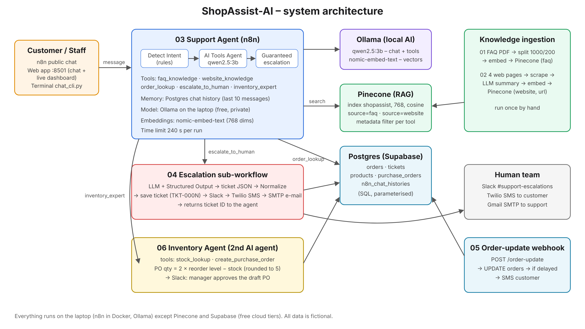

# ShopAssist-AI: An Agentic RAG Customer-Support Assistant for an Online Clothing Store

**Course:** Agentic AI for Business Automation – Individual Capstone
**Student:** Kritika Bhachawat · **Roll no.:** 065087 · PGDM (Business Data Analytics) 2025–27, FORE School of Management, New Delhi · **Submitted:** 10 October 2026 · **v2 update:** November 2026
**Repository:** https://github.com/kritikab01/ShopAssist-AI

> All company, customer and order data in this project is fictional.

---

## 1. Business problem

UrbanThread is a small Indian online clothing brand (prices in Rs) with two support staff. Most incoming
messages are repetitive: order status, return window, refund timelines, size advice, delivery charges and
COD rules. This causes:

- slow first responses during sales (e.g. Diwali), when message volume is highest;
- angry or high-value cases waiting in the same queue as simple questions;
- no structured record of escalated issues, and no automatic alert to the team;
- customers not being told proactively when an order is delayed.

## 2. Objectives

1. Answer common questions instantly, 24×7, **only** from the store's own policies and web pages (no hallucinated policies).
2. Let customers check order status with an order ID or phone number.
3. Detect cases that need a human (anger, refund > Rs 5,000, unknown answer) and hand them over with a structured ticket and instant alerts (Slack, SMS, e-mail).
4. Notify customers by SMS automatically when an order is delayed.
5. Build it in n8n using every topic of the course, with **zero budget**: local AI (Ollama) and free tiers, no credit card needed.

## 3. Architecture

| Layer | Technology |
|-------|-----------|
| Orchestration / agent | n8n 2.x self-hosted in Docker – AI Agent (Tools Agent) |
| LLM | Ollama `qwen2.5:3b`, running locally (free, no API key, supports tool calling) |
| Embeddings | Ollama `nomic-embed-text` (768 dims, local) |
| Vector DB | Pinecone index `shopassist` (768 dims, cosine), metadata `source`, `url`, `title` |
| Database + memory | Supabase Postgres (`orders`, `tickets`, `n8n_chat_histories`) |
| Notifications | Slack API, Twilio SMS, Gmail SMTP |
| Interface | n8n public hosted chat, web app with live dashboard (port 8501), Terminal chat; webhook for the order system |

## 4. Workflow-by-workflow explanation

### 4.1 Workflow 01 – Ingest FAQ PDF
Manual trigger → HTTP Request downloads `store_faq.pdf` → **Default Data Loader** (PDF) with metadata
`source=faq` → **Recursive Character Text Splitter** (chunk 1000, overlap 200) → **Ollama embeddings** →
**Pinecone insert**. Overlap keeps sentences that cross chunk borders searchable.
_Screenshot: workflow canvas + Pinecone record count._

### 4.2 Workflow 02 – Scrape and summarize web pages
Manual trigger → read `urls.txt` → **Code** node creates one item per URL → **HTTP Request** fetches each
page → **HTML Extract** keeps body text without nav/footer → **Basic LLM Chain** (Ollama `qwen2.5:3b`,
temperature 0) summarizes each page into factual bullets → **Set** adds `url` and `title` → Pinecone insert
with metadata `source=website`, `url`, `title`. Summaries are shorter and cleaner than raw HTML, which
improves retrieval and lets the agent cite the page URL.
_Screenshot: summary output of one page._

### 4.3 Workflow 03 – ShopAssist support agent (public chat)
**Chat Trigger** (public hosted chat) → **AI Agent (Tools Agent)** with:
- **Postgres Chat Memory** – last 10 messages per session, so follow-ups like "and when will it arrive?" work;
- **faq_knowledge** – Pinecone retrieve-as-tool with metadata filter `source=faq`;
- **website_knowledge** – same index, filter `source=website`;
- **order_lookup** – Postgres tool; the LLM fills one parameter via `$fromAI()` and the query is
  parameterised (`$1`), which prevents SQL injection;
- **escalate_to_human** – Call n8n Workflow tool → workflow 04.

The system prompt (`prompts/agent_system_prompt.md`) forces the agent to answer only from tools, cite the
source, ask for an order ID when needed, refuse out-of-scope questions and escalate when the customer is
angry, the refund is above Rs 5,000, or no answer is found. Choosing *which* knowledge base to query per
question is the agentic-RAG part of the project.

**Guardrails around the agent (deterministic, no AI).** A small local model does not always follow the
prompt, so two rule-based steps wrap it. *Detect Intent* (before the agent) adds a short note to the message
for anger or a request for a human, refunds, stock questions, offers and coupon codes ("search the website,
never invent a code") and off-topic requests. *Guaranteed escalation* (after the agent) works like this: if the
customer is upset or asks for a human, or asks for a refund on an order above Rs 5,000 (amount read from
Postgres), and the reply has no `TKT-` ticket ID, the workflow calls workflow 04 itself and adds the ticket ID
to the reply. This is a human-in-the-loop safety net. Escalation never depends on the model alone.
_Screenshot: chat conversation + agent execution log showing tool calls._

### 4.4 Workflow 04 – Escalation sub-workflow
**Execute Workflow Trigger** receives `customer_name, phone, order_id, reason, conversation_summary` →
**LLM chain + Structured Output Parser** produces a ticket matching `prompts/ticket_schema.json`
(`issue_type`, `sentiment`, `priority` are enums; the Ollama model runs in JSON mode) → **Normalize Ticket**
(a Code node that fills any field the small model missed from the agent's inputs, so a ticket is always
created) → **Postgres insert** into `tickets` (returns
`TKT-000N`) → **Slack** message to `#support-escalations` → **Twilio SMS** to the customer →
**SMTP e-mail** to support → **Set** node returns the ticket ID to the agent. Notification nodes continue
on error so a missing phone number never breaks the chat.
_Screenshots: Slack alert, SMS on phone, e-mail, `tickets` row._

### 4.5 Workflow 05 – Order-update webhook
**Webhook** `POST /webhook/order-update` with `order_id`, `status` (and optional
`new_expected_delivery`) → **Postgres UPDATE** → **IF** status = `delayed` → **Twilio SMS** to the customer
→ **Respond to Webhook** with JSON (`ok: false` for unknown orders).
_Screenshot: curl/Postman request and response + SMS._

### 4.6 Workflow 06 – Inventory Agent (second domain-expert agent)
The support agent (03) does not handle stock itself: it calls the **Inventory Agent** through the
`inventory_expert` tool (an agent used as a tool = multi-agent system). The Inventory Agent has its own
system prompt (`prompts/inventory_agent_prompt.md`) and two tools: **stock_lookup** (Postgres `products`,
search by name / SKU / size or "low") and **create_purchase_order** (inserts a `purchase_orders` row with
status *pending_approval*, cost = units × unit cost). A Slack message then asks a manager to approve it.
Customers only hear "in stock / out of stock"; managers get stock levels and purchase orders – the same
agent serves two business processes (customer service and procurement).
_Screenshots: workflow 06 canvas, chat asking "low stock", new PO row in Supabase._

### 4.7 Interfaces: web app, Terminal chat, one-word messages
- **Web app** (`app/server.py`, http://localhost:8501): chat with one-tap buttons and a **live dashboard**
  (orders by status, tickets, low stock, purchase orders) read from Postgres every 10 seconds.
- **Terminal chat** (`scripts/chat_cli.py`): ask anything interactively.
- **One-word messages**: the system prompt maps `UT1002` → order lookup, `returns` → FAQ, `diwali` → offers,
  `stock` / product names → Inventory Agent, `human` → escalation.

## 5. Course mapping

See `docs/course_mapping.md` for the full session-by-session table. Summary of the capstone line:

| Capstone requirement | Implemented in |
|----------------------|----------------|
| RAG with Pinecone | Workflows 01, 02, 03 |
| Scraping web pages and summarization | Workflow 02 |
| Send SMS using Twilio | Workflows 04, 05 |
| Slack API | Workflow 04 |

## 6. Results

Test plan: `docs/test_questions.md` (14 chat tests + 2 webhook tests). The 14 chat tests are run and scored
automatically by `python3 scripts/evaluate.py`; paste the table from `docs/evaluation_results.md` here.

**Automatic evaluation score: 14 / 14 passed, average answer time 10 s** (local qwen2.5:3b through Ollama on a
MacBook Air, run on 11 Oct 2026). Before the guardrails were added the score was 9 / 14.

| # | Test | Expected | Actual (shortened) | Time | Pass |
|---|------|----------|--------------------|------|------|
| 1 | FAQ – return policy | 15-day policy | "return items within 15 days from the date of delivery..." | 23 s | ✅ |
| 2 | Website – Diwali code | DIWALI25 | "DIWALI25 – 25% off orders over Rs 2,499 from 20 October..." | 10 s | ✅ |
| 3 | Order lookup UT1002 | shipped, Delhivery | "Your order UT1002 is in the Shipped status. 1 Linen Kurta (S)..." | 5 s | ✅ |
| 4 | Combined UT1005 return + refund | order + 15-day policy + refund | mentions 15 days and refund, but also an unrelated "out of stock" remark | 14 s | ✅* |
| 5 | Missing order ID | asks for ID/phone | "Could you please provide your order ID or phone number?" | 3 s | ✅ |
| 6 | Angry customer UT1003 | ticket ID | order UT1003 delayed (Ekart) + ticket TKT-0007 (Rohan Gupta, delivery, high) | 13 s | ✅ |
| 7 | Out of scope (Python script) | polite refusal, no code | "...only help with UrbanThread orders, returns, sizes, delivery, offers and stock." | 2 s | ✅ |
| 8 | Refund > Rs 5,000 (UT1004) | escalation | "refund amount exceeds Rs 5000, I need to escalate..." – ticket TKT-0008 (Sneha Iyer, refund, high) | 12 s | ✅ |
| 9 | One word: `UT1003` | order status | "Your order UT1003 is delayed..." (Ekart) | 7 s | ✅ |
| 10 | One word: `returns` | 15-day policy | "Returns and exchanges are processed within 15 days..." | 16 s | ✅ |
| 11 | One word: `diwali` | DIWALI25 | "Diwali offers ... 20 October to 5 November 2026 – DIWALI25: 25% off..." | 14 s | ✅ |
| 12 | Inventory: kurta size M | in stock | "The linen kurta is in stock and available in size M." | 5 s | ✅ |
| 13 | Inventory: low stock | low-stock SKUs | "products at or below their reorder level: Basics Cotton T-shirt (L): Stock 6..." | 12 s | ✅ |
| 14 | Inventory: purchase order | PO-000N | "A purchase order (PO-0002) has been created for Rs 1,800" | 7 s | ✅* |
| W1 | Webhook delayed UT1002 | DB updated + SMS | tested in setup (`scripts/test_chat.py`) | – | ✅ |
| W2 | Webhook unknown order | `ok: false` | tested in setup | – | ✅ |

\* passed the automatic check, but a human reading found a wrong detail (see observations).

**Screenshots** (all in `docs/screenshots/`):

| Fig | What | File |
|---|---|---|
| 1 | Architecture | [architecture.png](screenshots/architecture.png) |
| 2–8 | Workflow canvases 01–07 | [wf01](screenshots/wf01.png) · [wf02](screenshots/wf02.png) · [wf03](screenshots/wf03.png) · [wf04](screenshots/wf04.png) · [wf05](screenshots/wf05.png) · [wf06](screenshots/wf06.png) · [wf07](screenshots/wf07.png) |
| 9 | Escalation run (chat → ticket) | [exec03_escalation.png](screenshots/exec03_escalation.png) |
| 10 | Inventory Agent drafting a purchase order | [exec06_po.png](screenshots/exec06_po.png) |
| 11 | Web app: customer chat | [app_chat.png](screenshots/app_chat.png) · [app_mobile_dark.png](screenshots/app_mobile_dark.png) |
| 12 | Web app: Ops HQ manager dashboard | [app_ops.png](screenshots/app_ops.png) |
| 13 | Purchase-order review page (workflow 07) | [po_review.png](screenshots/po_review.png) |

**Observations:**

- **Speed:** 2–23 s per answer on a laptop, 10 s on average. Knowledge-base answers (1, 10) are slowest because they
  need an embedding call, a Pinecone search and a longer answer. Database answers (3, 5, 12) take 3–5 s.
- **Guardrails made the difference.** The first run scored 9 / 14. Two failures (6, 8) came from the small model
  *saying* it had escalated without calling the tool, one (2) from an invented coupon code, and two (13, 14) from
  time-outs. Model instructions alone did not fix these. Deterministic rules did: the *Detect Intent* pre-check,
  the *guaranteed escalation* step after the agent, the ticket *Normalize* step, time limits on every workflow,
  and default values for tool inputs. **Business rules that matter (escalation, refund limit) are enforced in the
  workflow, not left to the model.**
- **Wrong details found by reading the answers.** Keyword scoring misses these:
  - Test 4 added an unrelated "out of stock" sentence. Fix: a pre-check note that sends return questions to
    `order_lookup` + `faq_knowledge` only.
  - Test 6 gave the delivery date one day early (time-zone shift of a DATE column). Fix: dates are returned as text.
  - Test 14 ordered 10 units and said "restocked". Fix: the SQL now never orders fewer units than the rule
    (2 × reorder level − stock, rounded up to 5 → 35 units), and the agent must call it a *draft awaiting approval*.
- **Multi-agent works:** the support agent passed stock questions to the Inventory Agent (12–14), which queried
  the `products` table and drafted a purchase order in `purchase_orders`.

### Business KPIs

From `python3 scripts/kpi_report.py` on the live Supabase database (11 Oct 2026, testing period):

| KPI | Value |
|---|---|
| Conversations handled by the AI | **44** (48 customer messages) |
| Escalated to a human (tickets) | **8** – all high priority, all open |
| Conversations resolved without a human (approx.) | **82 %** |
| Products at or below reorder level | **5** of 12 |
| Purchase orders drafted by the Inventory Agent | **2** (pending approval) |

| Tickets by type | Count |
|---|---|
| refund (high) | 6 |
| delivery (high) | 2 |

| Low-stock SKU | Product | Stock / reorder level |
|---|---|---|
| TSH-BAS-L | Basics Cotton T-shirt (L) | 6 / 20 |
| JNS-RLX-28 | Relaxed Jeans (28) | 0 / 10 |
| KUR-LIN-S | Linen Kurta (S) | 3 / 8 |
| PLZ-COT-S | Cotton Palazzo (S) | 4 / 8 |
| HOD-OVR-XL | Oversized Hoodie (XL) | 9 / 10 |

Orders: 10 worth Rs 30,285 (3 shipped, 2 delivered, 1 delayed, 1 out for delivery, 1 placed, 1 returned,
1 cancelled). The numbers come from repeated testing, not real customers. In live use, the "resolved without a
human" share is the main KPI: about 4 in 5 conversations needed no staff time.

### Re-run on 22 Nov 2026 (v2: 17 tests, stricter scoring)

v2 grades every answer three ways: keywords, a live-database fact check and an AI judge (a second, larger
model, `qwen2.5:14b`) that flags invented facts. Full table: `docs/evaluation_results.md`; KPIs:
`docs/kpi_report.md`.

| Run | Passed | Avg. time | Avg. judge score | What changed |
|---|---|---|---|---|
| 1 | 5 / 17 | 48 s | 2.6 / 5 | judge fell back to the 3B chat model and marked correct answers as invented; 2 chats hit the 240 s time-out |
| 2 | 9 / 17 | 42 s | 3.8 / 5 | judge uses `qwen2.5:14b`; replies capped at 700 tokens (`numPredict`) – no more time-outs |
| 3 | 9 / 17 | 25 s | 3.5 / 5 | one-ticket-per-escalation fix (below) |

**Observations from the re-run:**

- **Stricter scoring is the main reason for the lower score than v1's 14 / 14.** Keyword checks passed on all 17
  answers in run 3; the judge failed 8. A few of those are the judge being wrong (test 7 declined the Python
  request correctly), most are real mistakes of the 3B model: an extra "keep exact change ready" in the
  returns answer (1), a refund promised instead of escalated (8), an answer in Hindi script to a Hinglish
  question (16), invented offer details (11).
- **Run-away answers fixed.** The small model sometimes kept generating until the workflow time-out (combined
  and Hinglish questions). Capping each reply at 700 tokens with a small repeat penalty removed every time-out
  and halved the average answer time (48 s → 25 s).
- **Duplicate tickets fixed.** The KPI report showed tickets in pairs: when the agent escalated through its tool
  but did not write the ticket ID in its reply, the guaranteed-escalation step created a second ticket. The
  agent now returns its tool steps and the step checks them. Tested: 3 angry messages → exactly 3 tickets, in
  both cases (agent escalated itself / step escalated). Tickets before the fix (TKT-0013 – TKT-0024) include
  duplicates, so the KPI ticket counts below 22 Nov are inflated.
- **Next step for quality:** the same workflows with a bigger chat model (`qwen2.5:14b`, or Groq in the cloud
  profile) should fix most remaining judge failures, at the cost of slower answers on a laptop.

KPIs on 22 Nov 2026 (live database, testing traffic only): 107 conversations, 72 % resolved without a human,
30 tickets (see note on duplicates above), 26 verified identity checks and 3 blocked wrong-digit attempts,
5 low-stock products, 6 draft purchase orders.

## 6b. Version 2 (November 2026): closing the gaps

After submission, every limitation that an interviewer or reviewer would spot was fixed:

| Gap in v1 | What v2 does | Where |
|---|---|---|
| Anyone with an order ID could see the order | **Identity check**: order ID + last 4 digits of the phone; every check logged; 5 wrong tries in 15 min lock the order. The fallback reply never shows unverified details. | `order_lookup` SQL (03), `verification_attempts` |
| Re-running ingestion duplicated vectors | One Pinecone **namespace per knowledge base** (`faq`, `website`), emptied and refilled on every run | 01, 02, 03 |
| English only; sarcasm missed | **Hindi / Hinglish** detection and replies; sarcasm, ALL CAPS and "!!!" count as anger | `prompts/detect_intent.js` |
| PO approval was only a Slack message | **Workflow 07**: secret-token review link → Approve / Reject (POST) → Slack + supplier SMS; also from the dashboard | 06, 07, web app |
| Keyword-only evaluation | **AI judge** (1–5, flags invented facts) + **live-database fact check**; 17 tests incl. privacy, Hinglish, sarcasm | `scripts/evaluate.py` |
| No automated tests | **58 pytest tests** + **GitHub Actions CI** (lint, generated-file check, Node-run guardrails, every SQL query on Postgres 16) | `tests/`, `.github/workflows/ci.yml` |
| ~60 min manual setup | **One command**: `bash scripts/up.sh` (Docker Compose: Postgres + n8n + app) | `docker-compose.yml` |
| Only on the laptop | **Public demo link** (Cloudflare tunnel) and a **cloud version** (Render + Groq + Cohere) | `docs/DEPLOY.md`, `render.yaml` |
| Basic dashboard | Redesigned app: chat with order/ticket/coupon badges, 👍/👎 feedback (CSAT), **Ops HQ** with PO approvals, live order feed, identity-check stats; admin key + rate limit for public use | `app/` |

New tables: `verification_attempts`, `order_events` (status history), `chat_feedback`; new columns for ticket language
/ resolution time and PO approval. All changes are additive, so the v1 database upgrades with `setup_database.py`.

Verified in a sandbox on **n8n 2.48.7 + Postgres 16**: all 7 workflows import and publish; the PO approval loop
(review page, wrong token, approve, double-approve); the order webhook history; and, with the AI model switched off,
the deterministic safety net still answered verified orders, refused wrong digits, and created tickets for a
refund above Rs 5,000 and for an angry Hinglish message (reply and ticket in Hinglish).

## 7. Limitations

- Fictional data and small knowledge base (1 PDF, 4 pages); real stores need regular re-ingestion.
- Identity check uses the last 4 phone digits (plus lockout), not a real OTP by SMS; production should send an OTP.
- Anger, sarcasm and Hinglish detection are rule-based (word lists); unusual phrasing can still be missed.
- Twilio trial sends only to verified numbers and adds a trial prefix to messages.
- The AI judge is itself a model and can be wrong; the 17 tests are a small sample.
- A small local model (3B parameters) is slower and makes more mistakes than large cloud models; answers depend on the laptop's speed.
- The local version works only while the computer is on; the free cloud version sleeps after 15 minutes idle.
- English, Hindi and Hinglish only; the local embedding model is English-first (the cloud version uses multilingual embeddings).

## 8. Future scope

1. **Real OTP by SMS** (Twilio Verify) instead of the last-4-digits check.
2. **Flowise version:** rebuild the same agent in Flowise to compare low-code agent builders.
3. **Bigger or cloud models:** compare the local `qwen2.5:3b` with `qwen2.5:7b` or a hosted model (Gemini, GPT) for answer quality and speed.
4. WhatsApp channel via the Twilio WhatsApp API.
5. Automatic re-scraping on a schedule (safe now that ingestion replaces its namespace).
6. Ticket resolution workflow for staff (close ticket → `resolved_at` → resolution-time KPI).

## 9. Conclusion

ShopAssist shows how two domain-expert n8n AI agents (customer support and inventory) can combine two
RAG knowledge bases, a SQL database and a human-in-the-loop escalation path to automate routine customer support while making sure urgent and
high-value cases reach a person quickly through Slack, SMS and e-mail.
